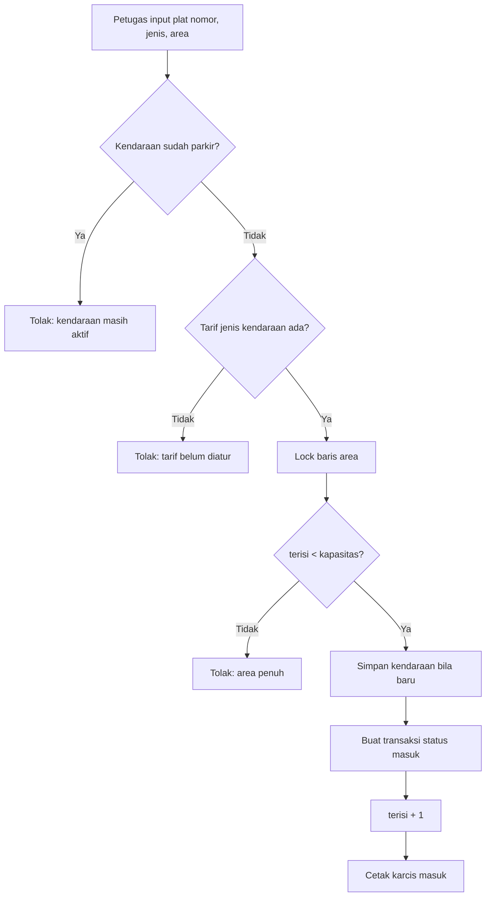
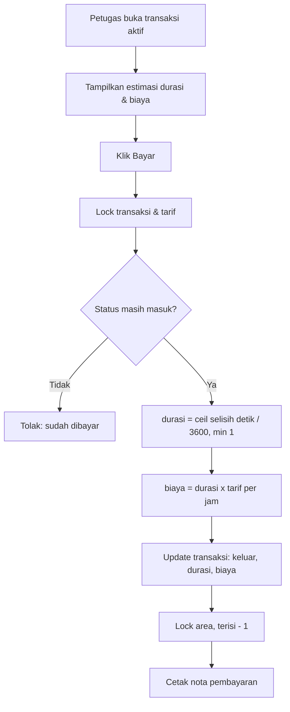

# Alur Bisnis Parkir

## 1. Check-In (Petugas)

Implementasi: `TransaksiController@store` dalam `DB::transaction` + `lockForUpdate()`.

## 2. Check-Out (Petugas)

Implementasi: `TransaksiController@bayar` + `App\Support\TarifCalculator`.

## 3. Log Aktivitas

Login, logout, CRUD master, check-in, dan check-out dicatat ke `tb_log_aktivitas`
melalui `LogAktivitas::catat()`.
