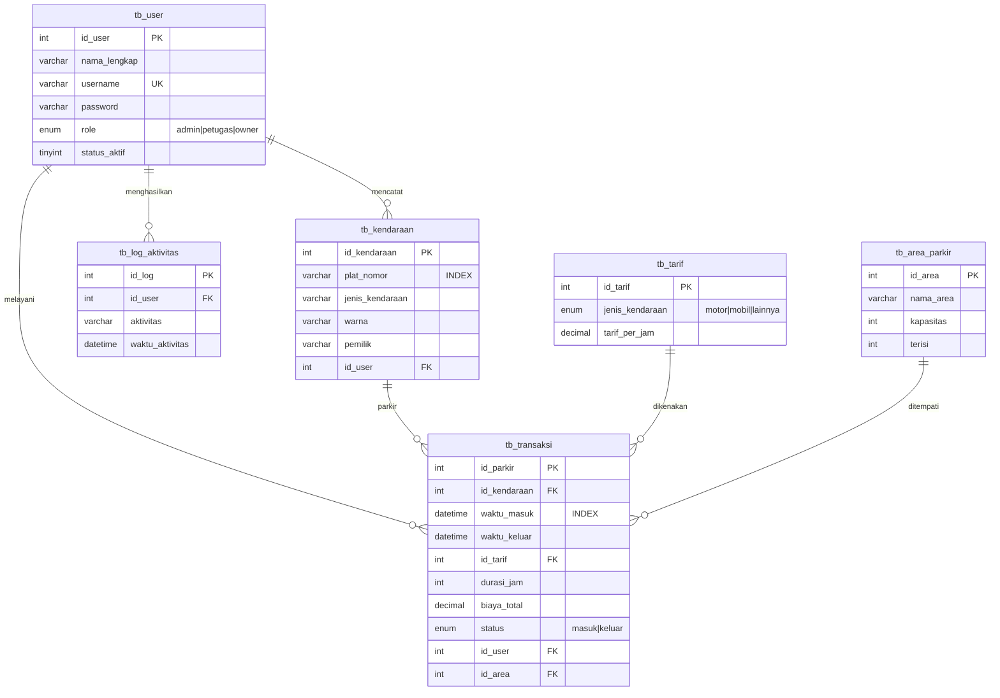

# ERD - Sistem Manajemen Parkir

Database: `db-kelola-parkir` (MySQL/MariaDB)

## Catatan

- `tb_transaksi.id_user` menyimpan petugas yang memproses check-in.
- `tb_kendaraan.id_user` menyimpan user yang mendaftarkan kendaraan.
- Index `plat_nomor` dan `waktu_masuk` sudah tersedia untuk pencarian dan laporan.
